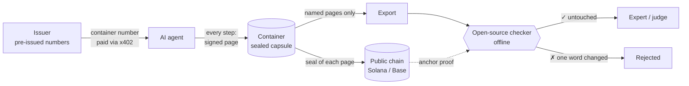
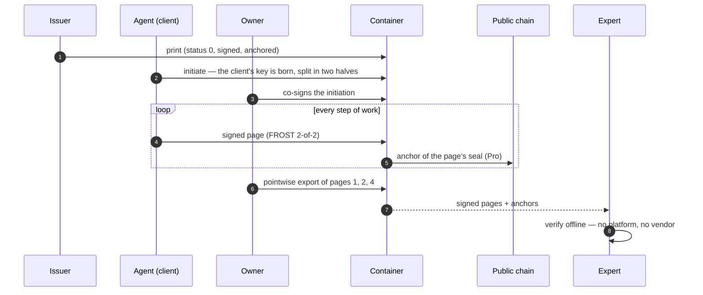
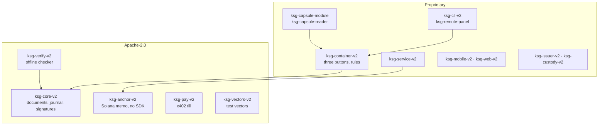
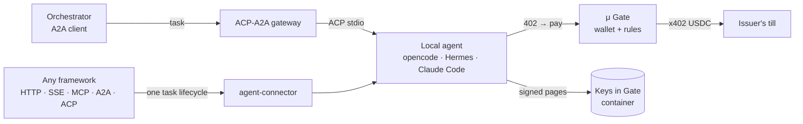

<div align="center">

# 🔐 Keys in Gate

### A flight recorder for AI agents

**Every step an AI agent takes becomes a signed page.<br/>Anyone can verify it offline — without trusting the platform that ran the agent, or us.**

[](rust-toolchain.toml)
[](#-checks)
[](LICENSE)
[](LICENSE-PROPRIETARY)
[](#-what-is-inside)
[](#-what-is-inside)
[](#-classes)
[](#-demo-meta-global-ai-developer-hackathon-2026)

[Why](#-why) · [How it works](#-how-it-works) · [Quick start](#-quick-start) · [Classes](#-classes) · [Inside](#-what-is-inside) · [Demo](#-demo-meta-global-ai-developer-hackathon-2026) · [Companions](#-companion-services) · [Checks](#-checks)

</div>

---

## 💡 Why

When an AI agent rejects an insurance claim, flags a bank customer or moves money, the only record of what it did is usually a log kept by **the same platform that ran it**. In a dispute that log is an argument, not evidence: it can be edited, completed after the fact or shown differently to different parties.

Keys in Gate turns the agent's work into evidence:

| | |
|---|---|
| 📝 **Recorded at the moment of work** | each step is a signed page; pages can only be added, never rewritten |
| 🕰️ **Time bound on both sides** | container numbers are issued in advance, pages are timestamped on a public chain — a record cannot be created backwards |
| 🔍 **Checked by anyone, offline** | an open-source checker, no access to our servers or the agent's platform |
| 🎯 **Only what is needed is disclosed** | an expert receives the named pages; the rest stays sealed |
| 🚫 **No witnesses, notaries or co-signers** | nobody has to be present or trusted while the agent works |

> [!NOTE]
> The EU AI Act requires automatic event logs for high-risk AI systems from August 2026, and courts already order AI logs to be produced.

---

## ⚙️ How it works



<details>
<summary><b>The life of one container</b></summary>



</details>

---

## 🚀 Quick start

> [!IMPORTANT]
> Rust **1.94.1** is pinned in [`rust-toolchain.toml`](rust-toolchain.toml); `rustup` picks it up automatically.

```bash
# build the reader (ksg-remote-panel) and the checker (ksg-verify-v2)
cargo build --release -p ksg-cli-v2 -p ksg-verify-v2

# the whole insurance channel, light form, no network:
# issuer → distributor → agent → enterprise → container → work → export → auditor
CLASS=light demo/insurance.sh
```

<details>
<summary><b>By hand: print, write three pages, export, verify, tamper</b></summary>

```bash
P=target/release/ksg-remote-panel; V=target/release/ksg-verify-v2
$P --home h init --class light
$P --home h packet && $P --home h buyer-key
$P --home h --mobile m.json initiate
$P --home h --mobile m.json open-journal
$P --home h --mobile m.json work --did "input: claim 4417"
$P --home h --mobile m.json work --did "tool call: policy_lookup(P-88) -> exclusion 7.2"
$P --home h --mobile m.json work --did "result: rejected, exclusion 7.2"
$P --home h --mobile m.json export-page --number 2 --by owner --out page.json
$P --home h keys --out keys.json
ID=$(python3 -c "import json;print(json.load(open('h/container.json'))['id'])")
$V --export page.json --container "$ID" --class light --keys keys.json   # ACCEPTED
```

Change one word in `page.json` and run the checker again: **REJECTED — the page is not under the seal.**

</details>

<details>
<summary><b>Pro with real anchors on a local Solana node</b></summary>

Needs the Solana CLI (`solana-test-validator`). The script brings up a node on `127.0.0.1`, funds a throw-away payer from the node's faucet, runs the chain in Pro, checks every page against the node and throws everything away.

```bash
scripts/demo_pro_localnet.sh
# p1: ACCEPTED (BoundPoint)
# p2: ACCEPTED (BoundPoint)
# p3: ACCEPTED (BoundPoint)
# bad: REJECTED: export: the page is not under the seal
# DEMO PRO LOCALNET OK
```

</details>

---

## 🧭 Classes

| | **`bare`** | **`light`** | **Pro** |
|---|:---:|:---:|:---:|
| Signed, hash-chained pages | ✅ | ✅ | ✅ |
| Post-quantum signatures (ML-DSA-65) | — | ✅ | ✅ |
| Hybrid key exchange (X25519 + ML-KEM-768) | X25519 only | ✅ | ✅ |
| Public timestamps | issuance only | Base Sepolia | **every seal**, Solana |
| Owner's seal on artefacts | — | — | ✅ |
| Attach to a Pro leader (coupling) | ✅ | — | — |

`bare` is the lightest form: ten operations, a fixed function table, attachable to a Pro "leader" container. See **[docs/bare.md](docs/bare.md)**.

---

## 🧱 What is inside



<details>
<summary><b>All crates</b></summary>

| Crate | Binary | What | License |
|---|---|---|---|
| `ksg-core-v2` | — | documents of major version 3 (JCS), the journal under the movable seal, Ed25519 + ML-DSA-65, Merkle (RFC 6962), statuses | Apache-2.0 |
| `ksg-verify-v2` | `ksg-verify-v2` | the third party's side: an export in, a verdict with time bounds out | Apache-2.0 |
| `ksg-anchor-v2` | — | Solana memo transactions, built and signed without an SDK | Apache-2.0 |
| `ksg-pay-v2` | `till` (example) | x402 seller's side, EIP-3009 USDC, checked before delivery | Apache-2.0 |
| `ksg-vectors-v2` | `ksg-vectors-v2` | deterministic test vectors | Apache-2.0 |
| `ksg-container-v2` | — | the container: three entry points and the rules on them; the capsule format | proprietary |
| `ksg-cli-v2` | `ksg-remote-panel` | the reader on a command line: a container on disk, anchoring, the channel's desks | proprietary |
| `ksg-capsule-module` | wasm | the container's code inside the capsule | proprietary |
| `ksg-capsule-reader` | — | the capsule's reader and the party's secret file | proprietary |
| `ksg-service-v2` | `ksg-service` | the network side: "who looked" desk, anchoring queue | proprietary |
| `ksg-issuer-v2` | — | emission, block allocation, closures | proprietary |
| `ksg-custody-v2`, `ksg-custody-proc-v2` | `ksg-custody` | the issuer's key, 3 of 5, in a hardened process | proprietary |
| `ksg-mobile-v2`, `ksg-web-v2` | wasm | the client's mobile half — phone and browser | proprietary |

</details>

<details>
<summary><b>Cryptography</b></summary>

| Purpose | Primitive |
|---|---|
| Page and document signatures | Ed25519 (strict) + ML-DSA-65 (FIPS 204) |
| The client's signing key | FROST 2-of-2 (RFC 9591) — the whole key never exists; one half with the client, one in the container |
| Key hand-over between holders | X25519 + ML-KEM-768 (FIPS 203), HKDF-SHA256, ChaCha20-Poly1305 |
| Canonical form | JCS (RFC 8785), integers 0 … 2⁵³ − 1 |
| Inclusion proofs | Merkle tree, RFC 6962 |
| The issuer's key | Shamir 3-of-5 over GF(256), in a process without core dumps or swap |

</details>

---

## 🎬 Demo: Meta Global AI Developer Hackathon 2026

> [!TIP]
> The scene: an agent built on **Muse Spark** triages a synthetic insurance claim ([`demo/case_4417.md`](demo/case_4417.md)) and rejects it. Every step lands as a signed page: its reading of the claim, the policy lookup, each Muse Spark call (model, request and answer hashes), and the damage mask from **SAM 3.1** (picture hash, box, mask hash). The agent then explains its decision for the judge, every sentence citing a page `[p:N]`; a program — not a model — checks that each citation points at a page that verifies offline.

| Piece | Where |
|---|---|
| Agent tools over MCP (`ksg_get_container`, `ksg_write_page`, `ksg_export_page`, `ksg_verify`) | [`scripts/ksg_mcp.py`](scripts/ksg_mcp.py) |
| The orchestrator hands the claim to the agent through an ACP-A2A gateway | [`scripts/demo_orchestrator.sh`](scripts/demo_orchestrator.sh) |
| Every Muse Spark call becomes a page (`ksg_model_call`); a SAM 3.1 damage mask becomes a page (`ksg_mask_damage`) | [`scripts/ksg_mcp.py`](scripts/ksg_mcp.py), [`scripts/ksg_model_api.py`](scripts/ksg_model_api.py) |
| The expert re-asks SAM 3.1 with the same box and compares the mask hash byte for byte | [`scripts/expert_recheck_mask.py`](scripts/expert_recheck_mask.py) |
| The judge explanation: every `[p:N]` must point at an existing page that verifies offline, or the explanation is refused | [`scripts/judge_explain.py`](scripts/judge_explain.py) |
| The judge page: pages ACCEPTED/REJECTED, the 6 MiB capsule, the expert SAM-mask ✓ and the explanation with clickable `[p:N]` — assembled at the end of the orchestrator into `demo/out/judge.html`; a labelled SAMPLE without a live run | [`scripts/judge_page.py`](scripts/judge_page.py), [`demo/sample/judge_sample.html`](demo/sample/judge_sample.html) |
| The container number paid with x402 through μ Gate — the agent never holds a wallet key | [`scripts/e2e_ksg_x402.sh`](scripts/e2e_ksg_x402.sh) |
| Pro with anchors on a local Solana node | [`scripts/demo_pro_localnet.sh`](scripts/demo_pro_localnet.sh) |
| The same chain on the capsule: print → initiation → three pages → export → ACCEPTED offline; a tampered page REJECTED | [`scripts/demo_pro_capsule.sh`](scripts/demo_pro_capsule.sh) |

### Built during the hackathon

- [x] **The capsule** — one fixed-size 6 MiB file indistinguishable from noise; each party holds one secret file; parts are sealed to the parties' maps (X25519 + ML-KEM-768)
- [x] Agent tools over MCP; the stand's demo chain
- [x] The container's code running inside the capsule: the module in wasmtime behind the two imports, a session of open → call ×N → close, the `ksg-capsule` command line; Pro end to end through the capsule on a local Solana node: initiation and journal opening with the owner's co-seal, three anchored pages exported and ACCEPTED, tampered pages REJECTED (K5)
- [x] Muse Spark: every model call recorded as a page; image evidence through SAM 3.1 (the mask is byte-identical when re-asked with the same box); the agent's explanation for the judge, its citations checked against the verified pages — the whole scene runs with one command (`scripts/demo_orchestrator.sh`), every page ACCEPTED
- [x] The client agent is named by the `did:key` of its own group key — two receivers never share an identifier

<details>
<summary><b>Prior work (before the hackathon)</b></summary>

The core (signed journal, FROST client key, post-quantum signatures, anchors on Solana and Base, offline checker), the ACP-A2A gateway and μ Gate existed before 26 October 2026. Two IETF Internet-Drafts describe the container and export formats: `draft-nam-ksg-core-00`, `draft-nam-ksg-journal-export-01`.

</details>

---

## 🤝 Companion services

Keys in Gate records *what* an agent did. Three open-source companions take care of *how* agents get their tasks, talk to each other and pay — so that every step of that work can land in a container.



<table>
<tr>
<td width="33%" valign="top">

### 🌉 [ACP-A2A gateway](https://github.com/GG-QandV/ACP-A2A_gateway)

Bridges local **ACP** agents (opencode, Hermes, Claude Code) and remote **A2A** clients: token auth, per-client conversation isolation, SSE streaming with a durable event log, non-blocking tasks, agent approvals.

**Why here:** an orchestrator in the cloud hands a claim to an agent on another machine — and the agent's work goes straight into its container.

</td>
<td width="33%" valign="top">

### 🛡️ [μ Gate](https://github.com/GG-QandV/agents-blockchain)

A local payment daemon for agents: **the agent never sees the wallet key**. The owner sets the rules — daily budget, whitelist, price caps per resource; every decision is logged in a hash chain. x402 over USDC on Base.

**Why here:** the agent pays for its own container number, within limits its owner set, without holding money.

</td>
<td width="33%" valign="top">

### 🔌 [agent-connector](https://github.com/GG-QandV/agent-connector)

A universal adapter runtime: local (stdio) and remote (HTTP / SSE / MCP / A2A / ACP) agents behind **one uniform task lifecycle**, with durable storage, idempotency, retention and protocol mappers.

**Why here:** any agent framework can reach the container's tools the same way — no glue code per protocol.

</td>
</tr>
</table>

---

## ✅ Checks

```bash
cargo test --workspace            # 1034 tests
cargo clippy --workspace --all-targets
scripts/test_split.sh cloud       # with cargo-nextest: the fast part
scripts/test_split.sh hermes      # the three slow suites (cli, base, devnet)
```

> The network half of K5 needs `solana-test-validator` and a funded payer; the anchor wait is 120 s (`KSG_ANCHOR_WAIT_S`); the test is `#[ignore]` — run it with `cargo test -p ksg-capsule-reader -- --ignored k5_network`.

> [!WARNING]
> The noise test of the capsule runs only optimized:<br/>
> `cargo test --release -p ksg-container-v2 --test capsule -- --ignored`

<details>
<summary><b>Stability rules</b></summary>

- Documents are canonical JSON (JCS) with `@context` = `urn:keysingate:core:v3`; a document with `v` above the supported one is rejected.
- Test vectors are deterministic: a re-run yields byte-identical files.
- The toolchain is pinned exactly; negative-compilation tests compare compiler diagnostics verbatim.

</details>

---

<div align="center">

**Keys in Gate** · open core under [Apache-2.0](LICENSE) · container and tools under [proprietary license](LICENSE-PROPRIETARY)

</div>
